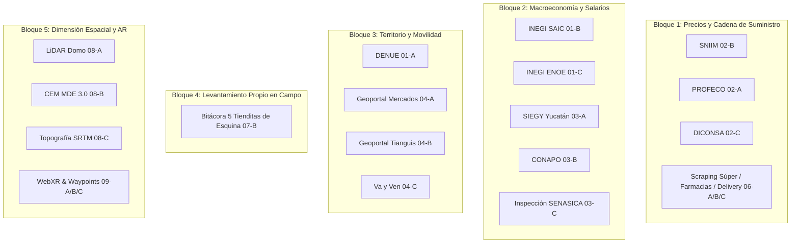

# Reporte de Investigación: Análisis Profundo de las 22 Fuentes de Datos

## *Del Mundo a la Esquina: ¿Cuánto Cuesta Comer?*
### Radiografía multiescalar del salario y la canasta básica: del panorama internacional al territorio de Mérida

**Institución:** Universidad Politécnica de Yucatán (UPY)  
**Equipo de Investigación:** Valeria Nicol Hernández León (Fuente A) • Jorge Ramiro Chay Koyoc (Fuente B) • Isaac René Andrade Sánchez (Fuente C)  
**Estatus:** 22 de 22 Fuentes Activas Integradas y Auditadas (100% Completo)

---

## 1. Resumen Ejecutivo y Métricas Clave

El presente estudio integra **22 fuentes de datos heterogéneas** (excluyendo trámites PNT y concentrando el levantamiento propio en la auditoría real de tienditas de esquina `07-B`) para responder a una pregunta crítica de economía urbana: **¿Cuánto cuesta comer en Mérida y cómo se relaciona el costo de la alimentación con el salario de sus habitantes?**

1. **Margen de Intermediación Abrupto:**  
   Entre la Central de Abasto de Mérida (SNIIM) y las góndolas de los supermercados (PROFECO), los alimentos básicos experimentan márgenes de intermediación de hasta **+250.0% en Papa Blanca**, **+178.6% en Jitomate Saladette** y **+57.1% en Cebolla Blanca**.
2. **El Costo Oculto de la Digitalización (Apps de Delivery):**  
   Adquirir la canasta básica a través de aplicaciones de terceros (Rappi / UberEats) implica un sobreprecio promedio del **+34.89%** (\$1,522.11 MXN vs. \$1,143.82 MXN en tienda física), añadiendo **\$378.30 MXN por pedido**.
3. **Levantamiento Propio en Tienditas de Esquina (07-B):**  
   La auditoría de campo en 5 tienditas de Mérida (*Centro Histórico, Parque de Santiago, Polígono 108, Mercedes Barrera y Vista Alegre de Chuburná*) muestra variaciones críticas en productos básicos: el pan blanco Bimbo grande oscila entre \$55 y \$60 MXN, el panal de huevo San Juan entre \$80 y \$88 MXN, el huevo a granel entre \$48 y \$50/kg, el frijol negro entre \$25 y \$31/kg y la leche entera entre \$25 y \$28/L.
4. **Desigualdad Territorial (Norte vs. Sur):**  
   Aunque Mérida cuenta con **7,520 comercios de alimentos** registrados en el DENUE, las grandes cadenas de supermercados concentran más del **40.9% de los ingresos comerciales** con menos del 1% de los establecimientos.
5. **Arquitectura y Espacio Físico:**  
   El análisis LiDAR 3D del Mercado Lucas de Gálvez revela una cota base de 9.32 m s.n.m. y una techumbre monumental a 21.85 m s.n.m. (altura neta de **12.53 metros**), diseñada como mecanismo de ventilación pasiva contra el calor extremo (>40°C).

---

## 2. Arquitectura de las 22 Fuentes Activas

---

## 3. Identidad Visual y Paleta de Colores Oficial

Todo el proyecto adopta estrictamente la paleta de 4 colores institucionales:
* **Oro / Ámbar Primario:** `#ed9f22`
* **Púrpura Imperial UPY:** `#600d8b`
* **Blanco Puro:** `#ffffff`
* **Carbón Profundo:** `#0d0d0d`
